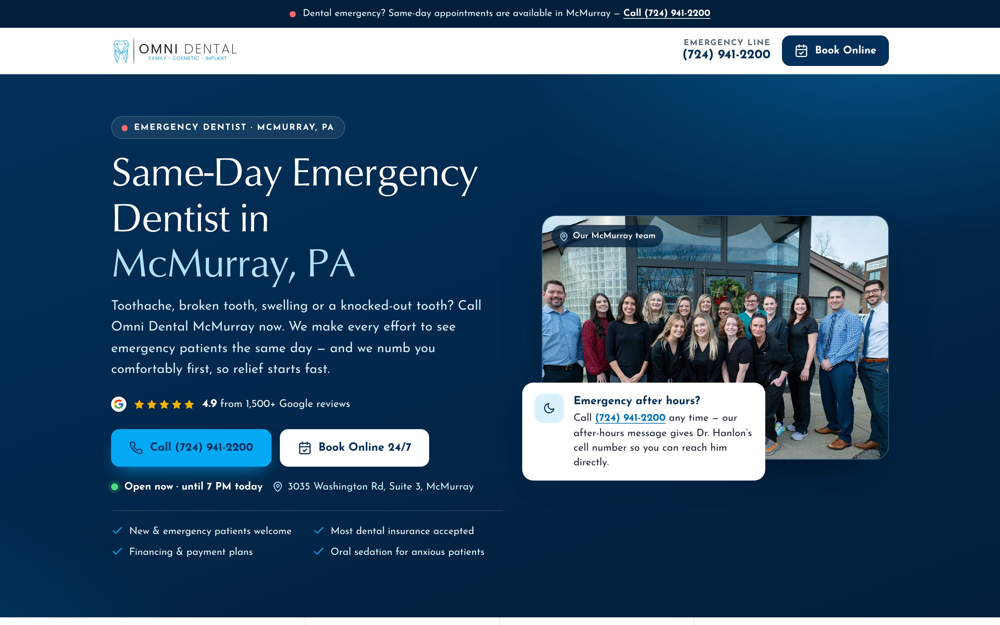

# Omni Dental McMurray — Emergency Dentist Google Ads Landing Page

A new, conversion-focused Google Ads landing page for **Omni Dental McMurray**
(3035 Washington Rd, Suite 3, McMurray, PA 15317). It replaces the current Unbounce
page at `/same-day-emergency-dentist-mcmurray/`.

| | |
|---|---|
| Page | [`emergency-dentist-mcmurray.html`](emergency-dentist-mcmurray.html) |
| Single-file version | [`emergency-dentist-mcmurray.standalone.html`](emergency-dentist-mcmurray.standalone.html) — every image and font embedded (~610 KB), works on its own anywhere. Rebuild after edits with `python3 tools/build_standalone.py` |
| Assets | [`assets/`](assets) — 10 optimised WebP photos, logo SVG, 2 self-hosted fonts (~410 KB total) |
| Every claim, sourced | [`docs/VERIFIED-FACTS.md`](docs/VERIFIED-FACTS.md) |
| Current live page (for diff/rollback) | [`original/`](original) |

---

## Before you publish — 5 things to confirm

1. **Street number.** The brief said *53035* Washington Rd. The website, schema, Google
   Business Profile and press all say **3035**, so the page uses 3035.
2. **After-hours line.** The page says the after-hours message gives Dr. Hanlon's cell
   number (straight from the site's own FAQ #9). It's a strong differentiator — confirm it
   is still true.
3. **$99 New Patient Special.** It's in the current LP's code but hidden at every screen
   width, so I treated it as switched off and left it out. If it's live, send the terms and
   I'll add it.
4. **Review numbers.** The page says **4.9 ★ · 1,500+ Google reviews**, from the practice's
   own Trustindex widget (1,502) and Birdeye (1,567+). The old LP's "810+" was stale.
5. **Nearby-areas line** (Peters Township, Canonsburg, Upper St. Clair, Bethel Park, Venetia,
   Cecil, South Park, Mt. Lebanon) is neighbouring geography, not practice-supplied. Trim it as you like.

## How to deploy

The page is a single standalone HTML file (all CSS and JS inline) plus an `assets/` folder.
Image and font paths are relative.

- **Static hosting / WordPress upload:** upload `emergency-dentist-mcmurray.html` (rename to
  `index.html` if needed) and `assets/` together, so `assets/` sits next to the HTML.
- **Unbounce:** paste the `<head>` contents into the page's Head scripts and the `<body>` into a
  Custom HTML block. Upload the files in `assets/` to the Unbounce image library (or any CDN),
  then find-and-replace `assets/` with that URL prefix.

Keep the canonical URL `/same-day-emergency-dentist-mcmurray/` so existing ads keep working.

## Tracking — already wired

| What | Detail |
|---|---|
| Google Tag Manager | `GTM-T5MQFN9` (same container as the current LP) |
| Meta Pixel | `519596633106235` PageView (same as current LP) |
| Liine call tracking | Same bootstrap script as the current LP. The page shows the main number **(724) 941-2200**; Liine swaps in the correct tracking number per source |
| Booking attribution | Every booking link keeps `referrer_id=3`. The script also appends `gclid`, `gbraid`, `wbraid` and `utm_*` from the landing URL |
| Click events → `dataLayer` | `lp_call_click`, `lp_book_click`, `lp_directions_click` (plus `lp_reviews_click`), each with `cta_location` (e.g. `hero-call`, `mobile-bar-call`). Add GTM triggers on these to fire Google Ads conversions if calls aren't already imported from Liine |

`<meta name="robots" content="noindex, follow">` keeps this paid page from competing with
the organic `/mcmurray-pa/emergency-dentist/` page. AdsBot ignores it, so Ads crawling and
Quality Score are unaffected. Delete the line if you want it indexed.

---

## Page structure and why

| # | Section | Job |
|---|---|---|
| 1 | Alert strip | Tappable emergency number above everything |
| 2 | Sticky header | Logo + "Emergency line" number + Book Online, always visible |
| 3 | **Hero** | H1 "Same-Day Emergency Dentist in McMurray, PA"; 4.9★ proof; Call + Book CTAs; **live open/closed status in Eastern time**; address; team photo |
| 4 | Trust bar | 4.9★ · same-day · 7 AM starts · 7 PM late hours |
| 5 | Emergencies we treat | 10 symptom cards so visitors see their problem is fixable + "Not sure?" CTA |
| 6 | Reviews | Google rating panel + real reviews, incl. an emergency review |
| 7 | Step by step | Removes fear of the unknown: call → diagnose → numb → your choice |
| 8 | Why Omni | "Why McMurray Trusts Our Emergency Dentists": keyword-rich intro, 8-point emergency checklist, then **9 emergency service cards** (toothache relief, emergency root canal, extractions & wisdom teeth, broken/cracked teeth, lost crowns & fillings, knocked-out/missing teeth, 3D diagnosis, after-hours & weekend, sedation) + Call/Book CTAs |
| 9 | Doctors + office photos | Real faces, credentials, real rooms and equipment |
| 10 | Insurance & payment | Carriers, Kleer membership, Cherry/CareCredit, payment methods |
| 11 | Location & hours | Address, call + directions buttons, hours with today highlighted, map |
| 12 | FAQ | 4 conversion-focused questions (same-day, after hours, new patients, walk-ins), also emitted as FAQPage JSON-LD. Cost and insurance are covered by the Insurance & payment section. Questions already answered elsewhere on the page were cut to keep it short |
| 13 | Final CTA | "Don't Wait Out the Pain" |
| — | Mobile action bar | Call Now · Book Online, fixed on phones and tablets |

**CTAs:** 14 tap-to-call links, 7 booking links, 1 directions link. The only other
outbound links are Google reviews, the Kleer plan and the Privacy Policy.

### Quality Score alignment

- **Ad relevance / keyword match:** "emergency dentist", "same-day", "McMurray, PA",
  "toothache", "broken tooth", "knocked-out tooth", "abscess", "wisdom tooth", "after hours",
  "walk in" and "open now" intents are each answered in a visible heading, card or FAQ.
- **Landing page experience:** fast (below), mobile-first, no pop-ups, clear NAP, real
  photos, transparent pricing and insurance info, privacy policy link.

### Brand fidelity

- Colours from the live site: navy `#02305a`, sky `#03a9f4`, pale `#aee3fb`.
- Fonts from the live site: its own heading face (self-hosted from the practice CDN) and
  Josefin Sans for body text.
- The official logo, plus the practice's own team, doctor and office photography.
- Tone is the site's own: warm, calm, "we listen", "made to feel like family".

---

## QA results

| Check | Result |
|---|---|
| Horizontal overflow at 390 / 768 / 1440 px | **0 px** at all three |
| Console / page errors | None |
| axe-core (WCAG 2.1 AA + best practice), mobile + desktop | **0 violations** |
| HTML validation (`html-validate`) | Clean, apart from the stylistic phone-hyphen rule (CSS keeps numbers from wrapping instead) |
| First Tab stop | "Skip to content" |
| Mobile LCP / CLS (simulated 4G, 4× CPU slowdown) | **0.56 s / 0.067** |
| First-party transfer on load | ~208 KB (third-party tags not included) |
| JSON-LD | `Dentist` + `FAQPage` (4 Q&As, generated from the visible FAQ) parse as valid JSON |
| Open/closed status | Correct for before-open, open, after-close, Friday evening, Saturday and Sunday night, including visitors in other time zones |
| `gclid` / UTM pass-through to booking | Verified |
| `dataLayer` click events | Verified for call, book and directions |

Contrast: the primary Call button uses navy text on sky blue (5.1:1) rather than the
main site's white-on-sky (2.6:1), which fails WCAG AA.
